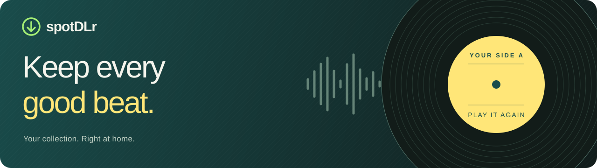
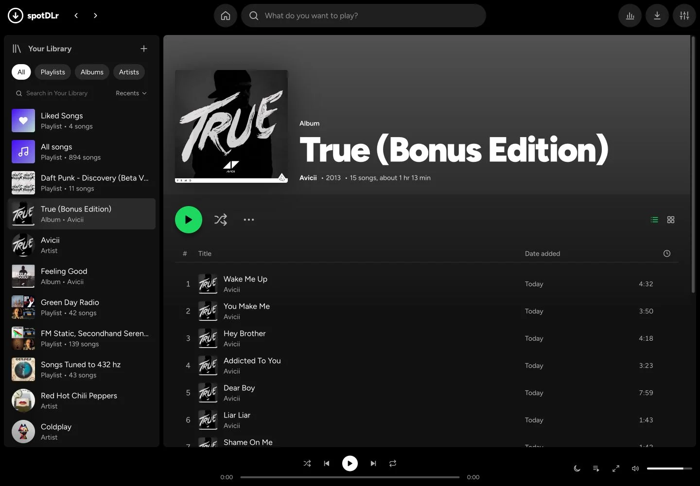

<p align="center">
  
</p>

<h1 align="center">Your music. A space of its own.</h1>

<p align="center">
  A local music library and player with a familiar interface.<br>
  Bring your files together, build your playlists, and get lost in a good album.
</p>

<p align="center">
  <a href="https://github.com/HoldenGrant/spotDLr-web_ui/releases/latest"></a>
  <a href="https://github.com/HoldenGrant/spotDLr-web_ui/actions/workflows/windows-installer.yml"></a>
  <a href="installer/MAC.md"></a>
</p>

<p align="center">
  <a href="https://holdengrant.github.io/spotDLr-web_ui/">Website</a> ·
  <a href="#download--press-play">Download</a> ·
  <a href="#a-little-more-you-in-every-listen">Features</a> ·
  <a href="SETUP.md">Setup guide</a> ·
  <a href="CHANGELOG.md">What's new</a>
</p>

<p align="center">
  <a href="https://holdengrant.github.io/spotDLr-web_ui/"></a><br>
  <sub>Current development preview. Released versions may look different.</sub>
</p>

## Download & press play

Both installers include **Python, FFmpeg, and Node.js**. No Terminal or source checkout is needed to run them.

| Windows | Mac |
| :--- | :--- |
| **[Download for Windows ↓](https://github.com/HoldenGrant/spotDLr-web_ui/releases/latest/download/spotDLr-Setup.exe)** | **[Download for Mac ↓](https://github.com/HoldenGrant/spotDLr-web_ui/releases/download/v2.4.0/spotDLr-2.4.0-mac-arm64.dmg)** |
| Run `spotDLr-Setup.exe`, then open spotDLr from the Start menu. | Open the DMG and drag spotDLr into **Applications**. |
| Uses an Edge or Chrome app window. | Native **Swift + Apple WebKit** window. |
| [Windows setup](SETUP.md#windows-the-installer-easiest) | **Apple Silicon · macOS 15+ · v2.4.0** · [Mac setup](SETUP.md#mac-personal-standalone-installer) |

The Mac download is a personal build without Apple notarization. First-launch help and instructions for moving an existing collection are in the [Mac setup guide](SETUP.md#mac-personal-standalone-installer).

**Your first listen:** open spotDLr → add your music with **+ → Add music files**, or search for a song → press play.

No Spotify account is required. Search uses **YouTube Music** by default; connecting Spotify is optional.

## A little more you in every listen

| | Make it yours |
| :--- | :--- |
| **A home for your collection** | Browse albums, artists, genres, and playlists built from your files' tags and cover art. Search, filter, and switch between list and grid views. |
| **Stay with the song** | Synced lyrics, fullscreen Now Playing, visualizers, Mac media keys, and swipe-to-skip on phones. Save available `.lrc` lyrics beside songs already in your library. |
| **Set the pace** | Play next, build a queue, shuffle, repeat, crossfade, even out volume, or drift off with a sleep timer. Schedule a song or playlist for later. |
| **Find your next favorite** | Search YouTube Music or connect Spotify. Paste supported song, album, playlist, and artist links; spotDLr marks what you already have and can download missing tracks. |
| **Keep the good copy** | Find duplicates, keep the copy you choose, and carry its likes and playlists forward. Fix album metadata with an undo option. |
| **See your listening habits** | Explore top songs, artists, genres, listening time, and activity by hour. Compare calendar periods or switch charts to table views. |
| **Take it to your phone** | Pair with a QR code on Wi-Fi, or use Tailscale for access away from home. Add the interface to your phone's home screen. |

### Your files stay yours

Music and settings live outside the installed app, so replacing the app preserves your collection.

| Installation | Music | Settings, likes & caches |
| :--- | :--- | :--- |
| Windows installer | Your Music folder → `spotDLr` | `%LOCALAPPDATA%\spotDLr` |
| Mac DMG | `~/Music/spotDLr/` | `~/Library/Application Support/spotDLr/` |
| From source | `<project>/downloads/` | The project folder |

**Listen offline** to files already on your computer. Search, downloads, artwork lookup, and lyrics lookup need an internet connection. Phone access streams from your computer, so spotDLr must remain running there.

<details>
<summary><strong>A few useful details before your next listen</strong></summary>

- **Audio formats:** M4A/AAC, MP3, Opus, FLAC, and WAV. **Auto** keeps the source quality; converting to a higher bitrate or a lossless format cannot restore detail absent from the source.
- **Spotify links:** without API access, the public embed supplies the track list, then songs are matched on YouTube Music. Public-playlist lookup is limited to the first 100 songs. See [optional Spotify setup](SETUP.md#optional-connect-spotify) for API requirements.
- **Lyrics:** existing `.lrc` files are preserved. Save one song from its **⋯** menu, or run a library pass in **Settings → Downloads**.
- **Phone playback:** music plays on the phone. On iPhone/iPad, crossfade and volume normalization are disabled; visualizers use a generated pattern so playback can continue with the screen locked.
- **Scheduled plays:** keep the designated app or browser running. On iPhone, it needs to remain on screen.
- **Quitting:** the Windows installer stops its backend after the last client window closes. In the Mac DMG build, closing the window keeps the app running; **⌘Q** stops its backend. The smaller source-dependent Mac launcher leaves the source server running after quitting.

</details>

## Find your way around

| Want to… | Start here |
| :--- | :--- |
| Find a song or paste a link | Use the top search bar; press `/` or `⌘K` to focus it. |
| Add your own audio files | **Your Library → + → Add music files**. |
| Make a playlist | **Your Library → + → New playlist**. Add songs from their **⋯** menus. |
| Queue the next track | **⋯ → Play next** or **Add to queue**. Open the queue with **Q**. |
| Open fullscreen Now Playing | Open Now Playing, then press **F** or use its fullscreen button; **Esc** exits fullscreen. |
| Pair your phone | **Settings → Phone access**. Scan the QR code. |
| Change formats, lyrics, or playback | Open **Settings**, using the sliders icon at the top right. |
| Change appearance | **Settings → Appearance**. Light, Dark or System, plus six accent colors. Saved automatically on each device. |
| Find a setting | Use the **Appearance, Playback, Downloads, Spotify, Phone access, and About** tabs. |
| Open a music folder | A song's **⋯ → Show in Finder** (Mac) or **Open containing folder**. Albums and playlists have **Open folder**; Downloads has **Open music folder**. |

Use **Space** to play or pause. On Mac, supported media keys also control playback.

## Built to run on your computer

The interface uses plain HTML, CSS, and JavaScript. A local FastAPI server scans your music, manages downloads, and streams audio with seek support. The Mac window uses the system WebKit; the Windows launcher uses Edge or Chrome.

<details>
<summary><strong>Run from source</strong></summary>

Use **Python 3.10–3.13**, **FFmpeg**, and **Node.js**. The source launchers prepare a private `.venv`; the full platform instructions are in [SETUP.md](SETUP.md).

```sh
git clone https://github.com/HoldenGrant/spotDLr-web_ui.git
cd spotDLr-web_ui
```

**Mac / Linux:** run `./run.sh`. On Mac, you can also double-click `run.command`. Open `http://localhost:8000` once the server starts.

**Windows:** run `make_launcher.bat` to create shortcuts, or use `run.bat` for the console launcher.

**Native Mac launcher from source:** run `./make_launcher.sh`. Building requires macOS 12.3+ and Xcode Command Line Tools. This smaller launcher uses the project folder and its installed runtime tools; keep that folder in place.

Spotify credentials are optional. If you connect Spotify, enter them in **Settings → Spotify connection**. They stay in the installation's local settings folder.

</details>

<details>
<summary><strong>Explore the project</strong></summary>

| Area | Files |
| :--- | :--- |
| API and local library | `app.py`, `library.py`, `paths.py` |
| Search and downloads | `ytmusic.py`, `spotify_api.py`, `spotify_embed.py`, `downloader.py` |
| Listening features | `lyrics.py`, `stats.py`, `loudness.py`, `schedules.py`, `abx.py` |
| Library management | `organize.py`, `cleanup.py`, `apple_music.py` |
| Phone access | `phone.py`, `tailscale.py` |
| Interface | `index.html`, `static/` |
| Desktop packaging | `desktop.py`, `launcher/`, `installer/` |
| Landing page | `website/` |

The [API reference](spotdl/architecture/API%20Reference.md) covers routes for the library, playback, downloads, lyrics, phone access, and more. The [architecture overview](spotdl/architecture/How%20It%20Works.md) explains how the pieces fit together.

</details>

<details>
<summary><strong>Test, build, and release</strong></summary>

With the project environment activated:

```sh
python -m unittest discover -s tests -v
```

**Windows:** [GitHub Actions](.github/workflows/windows-installer.yml) builds the installer, installs it, and runs smoke tests. Main-branch builds are available as workflow artifacts. Version tags publish a release after the checks pass.

Before tagging, commit all implementation changes, update `version.py` and [CHANGELOG.md](CHANGELOG.md), and verify the release commit contains the intended app code. The tag must match `VERSION`; it determines exactly what goes into the installer.

**Mac:** `./installer/build_mac.sh` creates the `.app`, DMG, and SHA-256 file. It verifies ad hoc signatures and runs an isolation test with the source folder, Homebrew, and external Python blocked. See [Mac packaging](installer/MAC.md) for build requirements and publication steps.

**Website:** changes in `website/` deploy to GitHub Pages when pushed to `main`. Its Mac download URL pins a verified release asset; upload a new Mac build before changing that URL.

</details>

## Guides & support

| Guide | What's inside |
| :--- | :--- |
| [Setup](SETUP.md) | Installers, source setup, Spotify connection, storage, and troubleshooting. |
| [Local deployment](DEPLOYMENT.md) | Server startup, ports, desktop behavior, updates, and phone access. |
| [Mac packaging](installer/MAC.md) | Build and verify a self-contained Apple Silicon app and DMG. |
| [Changelog](CHANGELOG.md) | Features and fixes by version. |
| [Issues](https://github.com/HoldenGrant/spotDLr-web_ui/issues) | Report a reproducible problem or suggest an improvement. |

## Made possible by

[Python](https://www.python.org/) · [FastAPI](https://github.com/fastapi/fastapi) · [Uvicorn](https://www.uvicorn.org/) · [yt-dlp](https://github.com/yt-dlp/yt-dlp) · [ytmusicapi](https://github.com/sigma67/ytmusicapi) · [spotDL](https://github.com/spotDL/spotify-downloader) · [Spotipy](https://github.com/spotipy-dev/spotipy) · [FFmpeg](https://ffmpeg.org/) · [Mutagen](https://github.com/quodlibet/mutagen)

<p align="center">
  <sub>Made by <a href="https://github.com/HoldenGrant">Holden Grant</a>. Independent project, unaffiliated with Spotify or YouTube. Only download content you have permission to use.</sub>
</p>
