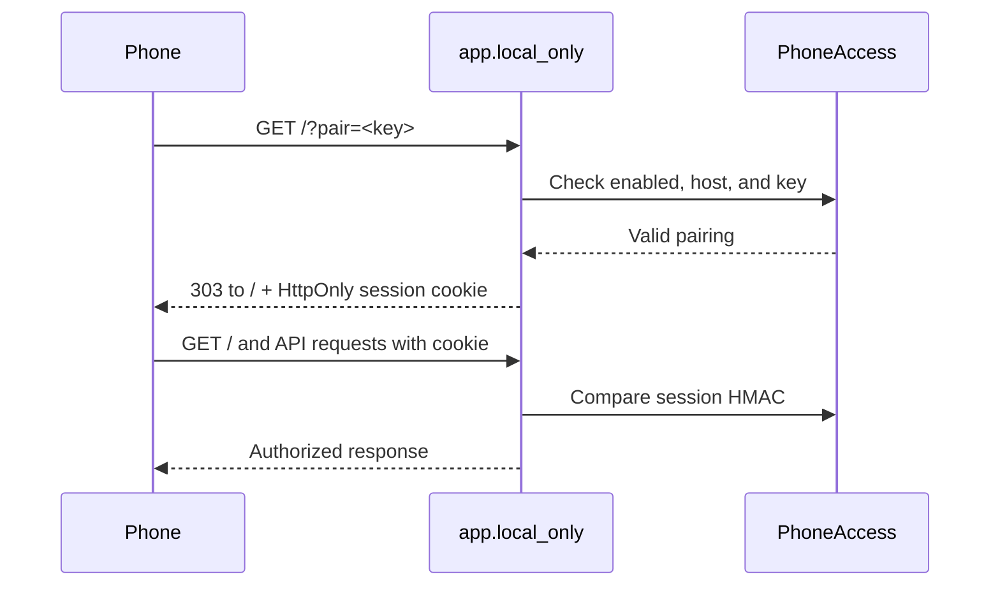

# Phone Access

Settings → Phone access pairs another browser with the server. Audio plays on that device, streamed from the computer. The computer must remain awake with spotDLr running.

Related: [[Home]] · [[Launchers & Setup]] · [[Backend]] · [[Playback and Schedules]] · [[API Reference]]

## Connection options

| Option | Connection | Requirement |
|---|---|---|
| Home Wi-Fi only | HTTP to the computer's Wi-Fi address | Same reachable network and paired browser |
| Anywhere with Tailscale | HTTPS to a `.ts.net` hostname | Tailscale running and configured on both devices, plus pairing |
| Tailscale Funnel | Same HTTPS hostname exposed through Funnel | Tailscale on the host, Funnel enabled, and pairing; client does not need Tailscale |

Off by default for a new configuration. Enabling Wi-Fi access creates a second Uvicorn listener bound to the detected Wi-Fi IPv4 address. The primary listener remains on loopback. Phone access tries its saved base port, then the next three ports, and checks for address changes every 20 seconds.

On macOS, the Wi-Fi URL uses the computer's `.local` hostname when available. `ip_url` provides the numeric-address fallback. Other devices' ability to resolve `.local` depends on their network.

## Pairing flow

The session cookie is named `spotdlr_phone`, lasts up to one year, and uses HttpOnly and SameSite=Lax. It is also Secure for the Tailscale HTTPS hostname. Redirecting removes the pairing key from the address bar.

The QR URL and `phone.json` contain the pairing key. Documentation records the mechanism, not a real key or QR URL.

## Pausing and signing out

- **Turn Phone access off:** stops the Wi-Fi listener and takes down this app's Tailscale/Funnel entry, while retaining the pairing key and selected options. Re-enabling restores access without requiring every browser to pair again.
- **New QR code:** replaces the key and invalidates cookies derived from the old key.
- **Restart:** reloads saved options from `phone.json` and starts access again if enabled.

Older notes/changelog wording that says disabling always signs phones out predates the pause behavior now implemented in `PhoneAccess.disable`.

## Request guard

`app.local_only` checks remote clients, allowed hosts, and pairing. Unpaired access receives a scan-the-code page at `/`, or JSON `403` on protected requests.

Writes to `/api/phone*` and `/api/credentials` are refused from phones. Writes carrying an `Origin` from a different host are also refused. Selected manifest, service-worker, and icon paths are public on recognized phone hosts so browsers can fetch home-screen resources without cookies.

This computer's own Wi-Fi/Tailscale addresses are treated as local by `PhoneAccess.is_remote`. Legacy `SPOTDLR_HOSTS` entries bypass the normal remote-pairing branch for those hosts; that option is a separate manual configuration, not part of QR pairing.

## Tailscale lifecycle

`tailscale.py` locates the CLI on PATH or common application paths, reads status JSON, and configures forwarding to `http://127.0.0.1:<local_port>`.

`serve_on` considers HTTPS ports 443 and 8443. It reuses an existing matching entry, skips occupied entries, and checks whether another local program holds 443 for a Tailscale address. The actual port comes from status; 8443 is a fallback, not a hardcoded requirement for every machine.

Funnel uses the selected HTTPS port and checks `AllowFunnel` afterward. A policy authorization URL can be returned to the UI when Funnel needs enabling. Turning Funnel off attempts to restore the private Serve entry on the same port.

## Home-screen app

`static/manifest.webmanifest` provides the app name, icons, and standalone display. The UI registers `/sw.js` on `.ts.net` hosts. The worker passes network requests through and substitutes an explanatory page when navigation cannot reach the computer; it does not store an offline music library.

The server fills a Wi-Fi home URL into that fallback page when appropriate. With Funnel active, it leaves that URL empty so the public worker does not reveal the local network name. Browser and installed home-screen sessions can have separate cookies/storage.

## Troubleshooting

| Symptom | Check |
|---|---|
| Scan-the-code page | Pair this browser with the current QR code; verify Phone access is on |
| Wi-Fi name fails | Try the numeric fallback and check that the phone can reach the same network |
| Tailscale link fails | Computer awake, spotDLr running, Tailscale connected; HTTPS configuration and selected port |
| Installed icon cannot connect | It still needs the computer; the service worker does not cache music |
| Scheduled play does not start | Keep the designated page open; on iPhone, on screen; see [[Playback and Schedules]] |

## Source references

`app.py`: `local_only`, `PhoneRequest`, `set_phone_access`, `service_worker`; `phone.py`: `PhoneAccess`, `local_name`, `wifi_address`; `tailscale.py`: `serve_on`, `funnel_on`, `funnel_off`; `static/app.js`: `openSettings`; `static/sw.js`; `static/manifest.webmanifest`.
