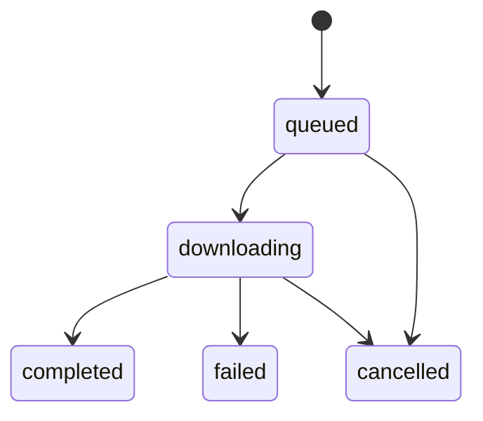

# Search and Downloads

Spotify supplies catalog information when connected; the app can also search and download through YouTube Music without Spotify credentials. Source and installed builds choose different download paths.

Related: [[Home]] · [[How It Works]] · [[Backend]] · [[API Reference]] · [[Data and Storage]]

## Search selection

`GET /api/search?q=...` chooses Spotify when its connection check succeeds, otherwise YouTube Music. `source=ytm` forces YouTube Music; `source=spotify` explicitly requests Spotify and can return its connection error. Empty queries return empty result lists.

The frontend also searches the local library. It rebuilds source-ID and title/artist indexes in `loadLibrary`, so ownership checkmarks can update after a download without repeating a cached remote search.

`GET /api/status/init` uses `spotify_api.check(wait=False)`: it returns cached status immediately and starts a refresh if needed. An initial YouTube Music status does not prove configured Spotify keys are invalid.

## Download selection

`app.download` selects the job source as follows:

| Query | Source build with working Spotify | Source build without Spotify | Frozen installer |
|---|---|---|---|
| YouTube Music URL | `ytm` | `ytm` | `ytm` |
| Spotify track/album/playlist URL | `spotify` | `spotify-embed` | `spotify-embed` |
| Free text | `spotify` | `ytm`, first matching song | `ytm`, first matching song |

`spotify` runs a spotDL subprocess. `ytm` uses `ytmusic.resolve` and yt-dlp. `spotify-embed` reads Spotify's public embed song list, matches songs on YouTube Music, and uses yt-dlp.

The installer always avoids the spotDL subprocess: `sys.executable` there is the desktop executable, not a Python interpreter. Search can still use connected Spotify credentials.

The YouTube Music and Spotify-embed paths reject whole-artist downloads. A source build with working Spotify passes a Spotify artist URL through to spotDL; the restriction is not universal across engines.

## Spotify fallback matching

`spotify_embed.item` parses the embed page's `__NEXT_DATA__` JSON. This depends on the public page format and only sees the exposed list; long playlists can stop at 100 songs. It does not paginate the Web API.

`ytmusic.spotify_items` resolves each missing song just before downloading it. `match_song` searches up to five YouTube Music songs and scores them with:

```text
score = 0.55 × title similarity + 0.45 × artist similarity
        - 0.30 when known durations differ by more than 10 seconds
accept only if score >= 0.70
```

This is a heuristic, not proof of an identical recording. Owned songs are checked by Spotify/YouTube ID before unnecessary matching or downloading.

## Queue lifecycle

`Downloader.submit` returns a job immediately and puts its ID on a `queue.Queue`. One daemon worker runs jobs serially.



The frontend polls `/api/jobs` every second while jobs are active, otherwise every 15 seconds. Finishing a job triggers a library refresh and rerender.

For spotDL jobs, completion depends on new files and recognized skips as well as the process result. Exit code zero with no new files or skips is a failure. A watchdog terminates after 300 seconds without output, or after `900 + 90 × expected_tracks` seconds overall.

For YouTube jobs, each song is attempted separately. A job can be `completed` with some failed songs when others succeeded or were already owned; read `message` and `error`, not only `status`. These jobs write ordered M3U8 references for albums/playlists, including songs owned in other folders.

Cancelling a queued job marks it cancelled. A running spotDL process is terminated. A running YouTube job checks cancellation between songs; the current extraction can finish first. Existing files are kept. Jobs and queue history are not persisted across restarts.

## Files and quality

Album/playlist downloads use a sanitized subfolder; single tracks go in the music root. The default is M4A with automatic source quality. The YouTube path uses FFmpeg extraction/conversion, writes tags and cover art, then moves the prepared file into the library. Optional synced lyrics are saved beside new songs when available. Existing songs have a separate **Download lyrics** action and background library pass; these do not redownload audio or appear in the music job queue. See [[Playback and Schedules#Saving lyrics for existing music]].

Choosing a larger bitrate or FLAC/WAV output cannot recover information missing from a compressed source. Source quality varies; the application does not provide a fixed bitrate guarantee.

`ytmusic.js_runtime` looks for bundled Node, then Deno, Node, or Bun on PATH. `ffmpeg_path` checks the bundled tool, PATH, then spotDL's downloaded copy. yt-dlp retries certain HTTP 403 failures with fresh extraction, up to three attempts.

## Source references

`app.py`: `search`, `spotify_item`, `download`; `downloader.py`: `submit`, `_worker`, `_run`, `_run_ytm`, `cancel`; `ytmusic.py`: `resolve`, `match_song`, `spotify_items`, `download_track`; `spotify_embed.py`: `item`; `spotify_api.py`: `check`; `static/app.js`: `loadLibrary`, `pollJobs`, `owned`.
